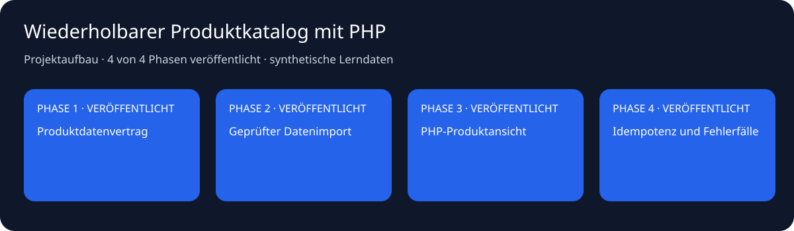

# Wiederholbarer Produktkatalog mit PHP

Produktdaten sollen in einen kleinen Katalog übernommen werden, ohne Preise zu verfälschen oder beim erneuten Import Duplikate anzulegen.



**Veröffentlichungsstand: Phase 4/4.** Dieses eigenständige Repository übernimmt zunächst den bereits lokal committeten Stand. Weitere fachliche Phasen werden im Abstand von mindestens vier Stunden veröffentlicht. Die technische Entwicklung und die öffentliche Veröffentlichung haben unterschiedliche echte Zeitpunkte.

## Was hier zu sehen ist

| Schritt | Inhalt | Hier veröffentlicht |
|---|---|---|
| 1 | Produktdatenvertrag | Ja |
| 2 | Geprüfter Datenimport | Ja |
| 3 | PHP-Produktansicht | Ja |
| 4 | Idempotenz und Fehlerfälle | Ja |

## Fachlicher Nutzen

Serverseitige Datenverarbeitung, centgenaue Preise, Transaktionen und HTML-Ausgabe.

## Lokal starten

Im geklonten Repository ausführen; die benötigte Laufzeit muss installiert sein. Python-Beispiele verwenden 3.12, Node-Beispiele 24 und C# die im Projekt angegebene .NET-Version. Befehle mit uv laden die dort genau bezeichneten Pakete bei Bedarf.

```powershell
python -X utf8 nachweise/pruefe_idempotenz.py php
```

Ausführliche technische Befehle: [START.md](START.md). [Öffentlicher Prüfstand](ABNAHME.json) und [Quellphasen](VERLAUF.json) dokumentieren Herkunft und echte Ausführungsdaten. Eine neue Repositorykopie ist kein neuer nativer Desktoplauf.

## Ergebnis des lokal geprüften Schlussstands

Echter PHP-/PDO-Lauf; wiederholter Import, ungültige Eingaben und Produktansicht geprüft.

## Grenzen

Kein Shopware, Pimcore oder Symfony. PHP benötigt PDO_SQLite.

Eigenes kleines Lernprojekt mit synthetischen Daten, mit KI-Unterstützung entwickelt und geprüft. Keine Aussage über Berufserfahrung, menschliche Arbeitsstunden oder praktische Verwendung weiterer nur geplanter Produkte.

## Entwicklungshistorie

[Entwicklungshistorie](HISTORIE.md): die vorhandenen lokalen Änderungen, ihre ursprünglichen Daten und die spätere GitHub-Übernahme.
